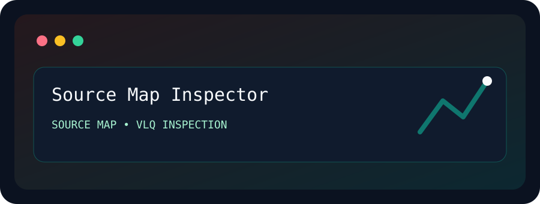

<div align="center">


[](LICENSE)
[](https://developer.mozilla.org/en-US/docs/Web/JavaScript)
[](https://github.com/CyberLoop-dev/sourcemap-inspector/stargazers)
[](https://github.com/CyberLoop-dev/sourcemap-inspector/commits/main)

**A local inspector for JavaScript source-map quality.**



</div>

## 🧭 Overview

Source Map Inspector reads a Source Map v3 JSON file and checks mapping segments, source and name indexes, and sourcesContent coverage. It makes no network requests and never uploads the map.

## ✨ Features

- 🧭 Validates Source Map v3 structure.
- 🔢 Decodes Base64 VLQ mapping segments and checks indexes.
- 📂 Reports missing sourcesContent entries and duplicate sources.
- 📊 Summarizes sources, names, generated lines, and segments.
- 🔒 Reads local files only; no telemetry or network calls.

## 🖥️ Demo

```bash
npm start -- examples/app.js.map
```
The included sample map is intentionally small and valid; try removing a mapping field to see a validation issue.

## 🚀 Quick Start

```bash
git clone https://github.com/CyberLoop-dev/sourcemap-inspector.git
cd sourcemap-inspector
npm install
npm start -- examples/app.js.map
```

## 🧱 Tech Stack

- 🟨 Node.js 18+
- 📦 Zero runtime dependencies
- 🧪 Node built-in test runner

## 🗂️ Folder Structure

```text
sourcemap-inspector/
├── main.js
├── package.json
├── examples/app.js.map
├── test/main.test.js
├── assets/illustration.svg
├── .gitignore
└── README.md
```

## 🛣️ Roadmap

- [x] Source Map v3 structure and VLQ checks
- [x] JSON and text reports
- [ ] Optional source path existence checks

## 🤝 Contributing

Issues and pull requests are welcome. Please include a clear reproduction or sample input and keep changes focused.

## 📄 License

Released under the [MIT License](LICENSE).

<div align="center">


</div>
